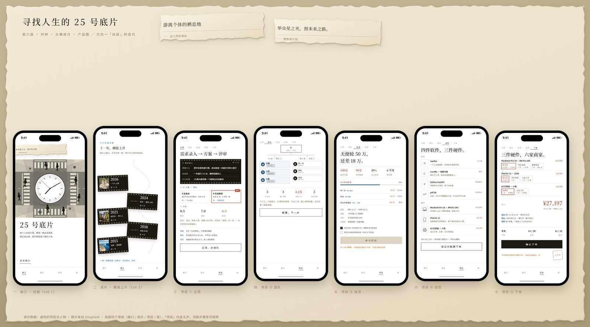
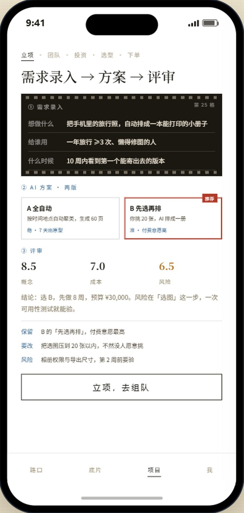
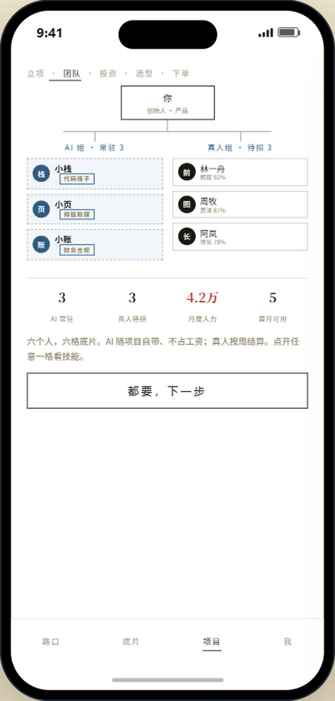
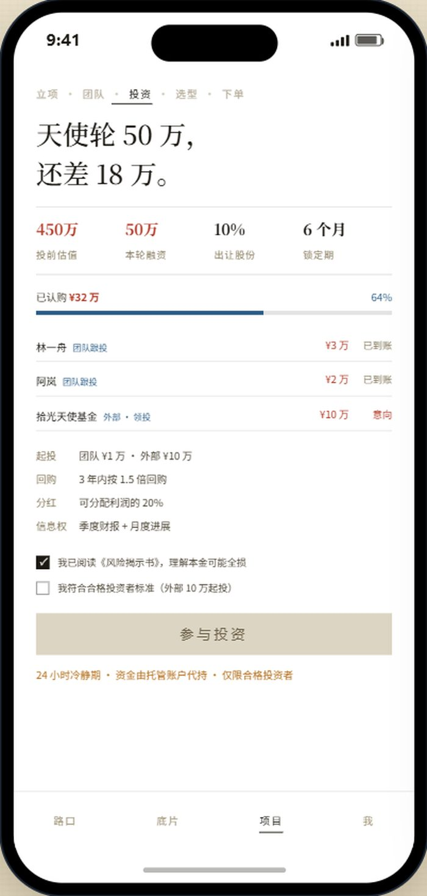

# 寻找人生的 25 号底片

一个 iOS 原型：把「我想做点什么」推到能开工的状态——找底片、立项、组队、融资、选型、下单。



## 怎么看

- **电脑**：双击 `design-demos/dir-1-v6.html`，宽屏看到的是七台手机的展板。
- **手机**：同一个文件，窄屏（≤900px）自动切成单机模式，左右滑动翻页，底部四个导航。
- **在线**：推到 GitHub 并开启 Pages 后，访问 `https://<用户名>.github.io/<仓库名>/`（根目录的 `index.html` 会跳到原型）。

## 它是什么

七页，四个底部导航（路口 / 底片 / 项目 / 我），「项目」内含五步：

| 页 | 做什么 |
|---|---|
| 路口 | 封面：夜晚的路口、一只占满路口的钟、被细线牵着走的人 |
| 底片 | 十一年个人信息，螺旋上升的胶片格，可插照片 |
| 项目 ① 立项 | 需求录入（黑底胶片框，第 25 格）→ AI 两版方案 → 评审（概念/成本/风险） |
| 项目 ② 团队 | 组织架构：常驻 AI 与待招真人两层，点头像看技能与个人底片 |
| 项目 ③ 投资 | 天使轮：估值、出让、认购进度、团队跟投与外部机构、条款；勾选风险揭示与合格投资者后才能认购 |
| 项目 ④ 选型 | 四件软件三件硬件，带产品图与选型理由 |
| 项目 ⑤ 下单 | 同一件硬件多家商家可选，价格与合计实时联动，末尾盖「已冲洗」 |

### 四处收尾

- **底片贯穿**：立项的「需求录入」做成黑底胶片框（第 25 格，带齿孔），下单页盖「已冲洗」印，第 2 页的胶片意象不再只停在前两屏。
- **投资合规**：风险揭示勾选 + 合格投资者认证，两项都勾才解锁「参与投资」；补充 24 小时冷静期与资金托管说明。
- **AI / 真人分层**：AI 成员浅蓝底虚线框、标注「常驻」；真人实线框、标注匹配度与可接档日。
- **字号与色彩**：正文 ≥11px、标题 26px；红色只表示钱，匹配度用蓝、风险与合规提示用橙。

<table>
<tr>
<td></td>
<td></td>
<td></td>
<td></td>
</tr>
</table>


## 目录

```
design-demos/   原型本体与历史版本、其他方向
  dir-1-v6.html   当前版本（单文件，双击即开）
  dir-1-v4/v5.html 历史存档
  dir-2/3.html    早期另外两个方向
docs/           设计文档（spec / 方向卡 / 逐屏稿 / 打磨记录）与截图
tools/          截图、点击测试、构建脚本（Node + Playwright）
index.html      指向原型的入口（给 GitHub Pages 用）
```

## 演示数据与素材

- 所有人物、机构、价格、估值均为**虚构演示数据**，不代表任何真实公司或个人。
- 底片里的三张照片来自 Unsplash（经 Picsum 调用），Unsplash License 允许免费使用。
- 撕纸上的两句文案（「游离个体的栖息地」「举众星之光，照未来之路。」）为设定文案，不是名人原句，页脚已注明。

## 已知限制

- 头像是剪影示意，不是真人照片。
- 投资流程只做了勾选与冷静期提示，未做真实的风险揭示书签署、合格投资者认证核验与资金托管。
- 设计体检脚本 `design_lint.py` 未跑（本机缺 Python 版 Playwright），视觉问题靠逐屏截图人工核对。

## License

MIT

## 开发脚本（可选）

`tools/` 里是截图与点击测试脚本，依赖 Node 与 Playwright，以及 huashu-design 的 Playwright 环境：

```bash
set HUASHU_SKILL=<你的 huashu-design 目录>   # Windows
node tools/shot-all.mjs                      # 重新截图
node tools/test.mjs                          # 点击回归
```

脚本里的路径都相对仓库根目录，不包含任何本机绝对路径。
