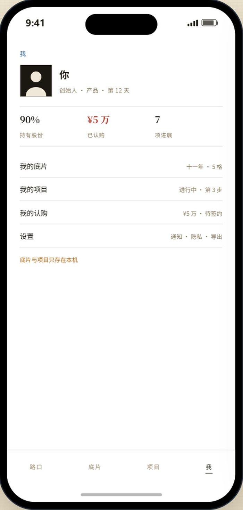

# 寻找人生的 25 号底片

一个 iOS 原型：把「我想做点什么」推到能开工的状态——找底片、立项、组队、融资、选型、下单。


## 怎么看

- **电脑**：双击 `design-demos/dir-1-v6.html`，宽屏看到的是七台手机的展板。
- **手机**：同一个文件，窄屏（≤900px）自动切成单机模式，左右滑动翻页，底部四个导航。
- **在线**：推到 GitHub 并开启 Pages 后，访问 `https://<用户名>.github.io/<仓库名>/`（根目录的 `index.html` 会跳到原型）。

## 它是什么

七页，四个底部导航（路口 / 底片 / 项目 / 我），「项目」内含五步：

| 页 | 做什么 |
|---|---|
| 路口 | 封面：夜晚的路口、一只占满路口的钟、被细线牵着走的人 |
| 底片 | 十一年个人信息，螺旋上升的胶片格；点开某一年看当年职位、技能与记录，还能补一条 |
| 项目 ① 立项 | 需求录入（黑底胶片框，第 25 格）→ AI 两版方案 → 评审（概念/成本/风险） |
| 项目 ② 团队 | 组织架构：常驻 AI 与待招真人两层，点头像看技能与个人底片 |
| 项目 ③ 投资 | 天使轮：估值、出让、认购进度、团队跟投与外部机构、条款；勾选风险揭示与合格投资者后才能认购 |
| 项目 ④ 选型 | 四件软件三件硬件，带产品图与选型理由 |
| 项目 ⑤ 下单 | 同一件硬件多家商家可选，价格与合计实时联动，末尾盖「已冲洗」 |

### 四处收尾

- **底片贯穿**：立项的「需求录入」做成黑底胶片框（第 25 格，带齿孔），下单页盖「已冲洗」印，第 2 页的胶片意象不再只停在前两屏。
- **投资合规**：风险揭示勾选 + 合格投资者认证，两项都勾才解锁「参与投资」；补充 24 小时冷静期与资金托管说明。
- **AI / 真人分层**：AI 成员浅蓝底虚线框、标注「常驻」；真人实线框、标注匹配度与可接档日。
- **字号与色彩**：正文 ≥11px、标题 26px；红色只表示钱，匹配度用蓝、风险与合规提示用橙。

<table>
<tr>
<td></td>
<td></td>
<td></td>
<td></td>
</tr>
</table>


## 目录

```
design-demos/   原型本体与历史版本、其他方向
  dir-1-v6.html   当前版本（单文件，双击即开）
  dir-1-v4/v5.html 历史存档
  dir-2/3.html    早期另外两个方向
docs/           设计文档（spec / 方向卡 / 逐屏稿 / 打磨记录）与截图
tools/          截图、点击测试、构建脚本（Node + Playwright）
index.html      指向原型的入口（给 GitHub Pages 用）
```

## 演示数据与素材

- 所有人物、机构、价格、估值均为**虚构演示数据**，不代表任何真实公司或个人。
- 底片里的三张照片来自 Unsplash（经 Picsum 调用），Unsplash License 允许免费使用。
- 撕纸上的两句文案（「游离个体的栖息地」「举众星之光，照未来之路。」）为设定文案，不是名人原句，页脚已注明。

## 已知限制

- 头像是剪影示意，不是真人照片。
- 投资流程只做了勾选与冷静期提示，未做真实的风险揭示书签署、合格投资者认证核验与资金托管。
- 设计体检脚本 `design_lint.py` 未跑（本机缺 Python 版 Playwright），视觉问题靠逐屏截图人工核对。

## License

MIT

## 开发脚本（可选）

`tools/` 里是截图与点击测试脚本，依赖 Node 与 Playwright，以及 huashu-design 的 Playwright 环境：

```bash
set HUASHU_SKILL=<你的 huashu-design 目录>   # Windows
node tools/shot-all.mjs                      # 重新截图
node tools/test.mjs                          # 点击回归
```

脚本里的路径都相对仓库根目录，不包含任何本机绝对路径。

## AI 能力（真实调用）

底片页底部有一个「让 AI 读一遍」：

- 把十一年的记录结构化成 JSON（年份 / 身份 / 在做 / 城市 / 一句话 / 技能 / 记录），连同系统提示一起发给 DeepSeek API；
- 要求模型只返回 JSON：`strength`（擅长什么）、`evidence`（三条带年份的证据）、`openings`（AI 时代可以往哪打开）、`why`；
- 结果渲染成一张结论卡，带 token 用量；可「再读一次」或「带着结论去立项」。

**首次使用**：点按钮 → 填 API Key（sk-...）→ 保存。Key 只存在这台设备的浏览器 localStorage 里，不上传任何服务器。没有 Key 或调用失败时，可以点「先用演示结果」看效果。

**注意**：Key 存在本地等同于这台设备上的明文，演示请用临时 Key，用完点「清除」。生产环境必须改成服务端持有 Key（见下）。

**没做的部分**：BFF、限流、脱敏日志、评测集——这些是上线前必须补的。

### 立项的 AI

立项页的三个问题现在是可编辑输入（值存在本机），点「用 AI 生成」：

- 把「需求三问 + 底片摘要」一起发给模型；
- 要求返回 JSON：两版方案（`plans[]`）、推荐哪一版（`recommended`）、三维评分（`review.concept / cost / risk`）、结论、保留 / 要改 / 风险；
- 前端按字段渲染，推荐的方案自动加红框和「推荐」标，评分保留一位小数；
- 失败时在按钮下方给出可读错误，原有示例内容保留不变。

## 中英文切换

右上角（桌面展板）或「我」页的语言行可以切 中文 / EN：

- 全部界面文案走一张 ~250 条的词典（`I18N`），含按钮、标签、条款、成员简介、年份详情与 AI 面板；
- 数字做了换算：`¥32 万 → ¥320K`、`4.2万 → ¥42K`、`第 6 年 → Year 6`；
- 切换后自动扫描整页，含之后由 JS 生成的弹层；切回中文会还原原文；
- 语言存在 localStorage，刷新后保持；
- AI 生成的正文按模型当时理解的语言返回，界面外壳仍会跟着切。

已知：`中文` 这个切换标签本身保持中文（作为语言名）；AI 返回的长段落不随语言重写。

## BFF（把 Key 挪到服务端）

浏览器不再直接持有 DeepSeek Key。`server/` 是一个零依赖的转发层：

```
浏览器原型 ──POST /api/chat──▶ BFF ──Bearer Key──▶ api.deepseek.com
```

**本地跑**：

```powershell
.\server\run-local.ps1 -Key "sk-你的key"
```

然后在原型「未连接 · 点这里设置」里把**服务地址**填成 `http://localhost:8787/api/chat`，状态会显示 `BFF · localhost:8787`。

**部署**：Cloudflare Workers（`.\server\deploy-cloudflare.ps1`）或 Docker（`docker build -t dipian-bff server/`），详见 [`server/README.md`](server/README.md)。

已经做了：Key 只在服务端、模型白名单、请求体与消息长度上限、每 IP 分钟/天双窗口限流、CORS 白名单、错误不回显上游原文、日志不记内容。

还没做：多实例共享限流、接口鉴权、审计告警、成本熔断。
